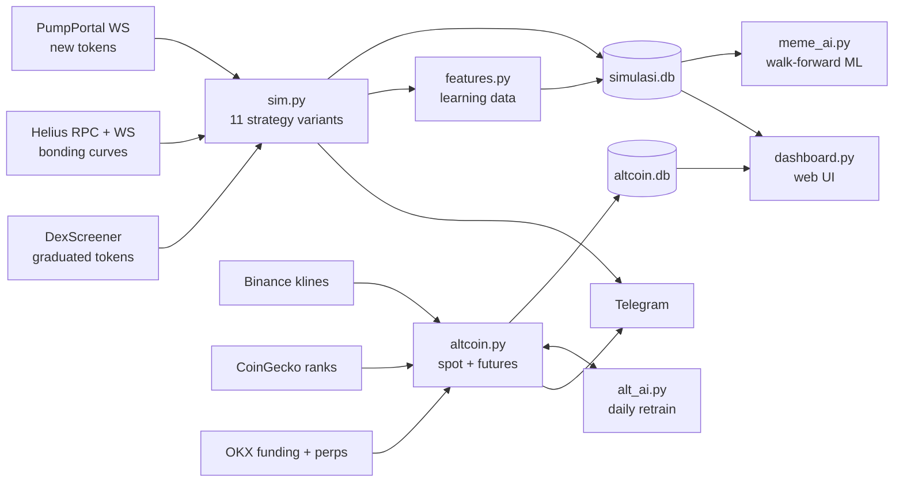

# Momo Quant Lab

**A paper-trading research lab for Solana meme coins and crypto altcoins.** It streams real on-chain and exchange data, runs many trading strategies side by side on the same feed, trains machine-learning models with walk-forward validation, and reports the results honestly, including when they lose.

> ⚠️ **Simulation only.** No wallet, no private keys, no real money. Nothing here is investment advice.

The project is documented in Bahasa Indonesia in [docs/PANDUAN.md](docs/PANDUAN.md), the full user guide. Research results are in [docs/findings.md](docs/findings.md).


---

## Screenshots

| Strategy Lab: leaderboard, equity curves, live feed | Risk analytics: result matrix, Monte Carlo, open positions |
|---|---|
|  |  |
| **Altcoin and futures: leaderboard with backtests, AI training report** | **Altcoin market: live equity, positions with liquidation price, trend scanner** |
|  |  |

## What it does

| Module | What it does |
|---|---|
| **Meme-coin simulator** (`sim.py`) | Listens to every new pump.fun token over WebSocket. It reads prices straight from the Solana **bonding-curve account** (Helius RPC plus real-time `accountSubscribe`), filters spam, and paper-trades **11 strategy variants in parallel**, each with its own $20 bankroll per round. |
| **Strategy Lab** (`strategies.py`) | A/B tests entry filters (observe window, SOL inflow, price multiple), anti-rug checks (dev selling, holder concentration), and exit rules (TP ladder, trailing stop, moonbag). The *Auto* variant picks the most statistically stable variant each round, scoring mean − std/√n, and sits out when everything is losing. |
| **Learning-data recorder** (`features.py`) | Records every token for 20 minutes: snapshots at 30/60/90/180 s, launch features (dev buy size, serial-creator count, copy-cat name count, socials), and the full price path so any exit rule can be replayed offline. |
| **Meme ML trainer** (`meme_ai.py`) | Replays each variant's exit rules over the recorded price paths with fees, dynamic slippage and network costs. It then trains a gradient-boosting classifier on entry-time features only and evaluates it walk-forward. |
| **Altcoin and futures simulator** (`altcoin.py`) | Covers the top 30 coins by market cap plus a watchlist. It runs **spot** strategies (EMA trend, breakout, RSI dip, 4h swing) and **perpetual futures** with leverage, long and short, isolated-margin **liquidation** and real **funding rates** (OKX). A daily backtest is shared with the live engine, and HODL BTC is the benchmark. |
| **Futures AI** (`alt_ai.py`) | Gradient boosting on 18 candle and market-regime features predicts 12-hour direction (up, flat or down, scaled by ATR). It is retrained daily. **Safety gate:** it may only trade a direction that was proven out-of-sample (≥200 signals, >50% hit rate, mean > costs). |
| **Dashboard** (`dashboard.py`, `web/`) | A real-time terminal-style web UI with live equity curves, a per-coin chart with trade markers, an animated execution pipeline with pixel-art characters, the strategy leaderboard and the AI training report. |
| **Telegram bot** | Sends trade alerts, round summaries, and the `/status`, `/laporan`, `/stop`, `/mulai` and `/alt` commands. |

## Architecture



## Engineering details
- **Async Python** (`asyncio`, `httpx`, `websockets`): one process for each simulator, with WebSocket reconnect and back-off.
- **Realistic costs:** a platform fee per side, slippage that grows with recent price velocity, a network fee per transaction, futures taker fees, funding and liquidation.
- **Crash-safe:** open positions are persisted and resumed after a restart. The SQLite schema migrates automatically. Backups run daily, and a single-instance lock prevents duplicate runs.
- **No look-ahead:** ML features use only information available at entry. Validation is time-ordered (train on older data, test on newer).
- **Read-only dashboard:** it opens the databases in read-only mode, so it can never corrupt the simulators.

## Key findings (so far)
The full write-up is in [docs/findings.md](docs/findings.md).
1. **Costs dominate.** Fees, slippage and network costs add up to about **11% per round trip** on a small meme-coin position. A coin that does nothing still loses money.
2. **No meme variant is profitable yet** after more than 4,000 simulated positions. Buying every new token was the worst at about −$400, so those variants were retired.
3. **A high AUC can mislead.** A first ML model reached AUC 0.80 at picking "profitable" tokens, but its top picks still averaged below 1× after costs. It had learned to spot *volatile* coins, not *rising* ones.
4. **Leverage magnifies a weak edge into large losses.** In backtests every futures strategy underperformed simply holding BTC.

The value of the lab is that it gives these answers quickly and honestly, before any real money is at risk.

## Quick start (Windows)
```bash
pip install -r requirements.txt
copy .env.example .env        # then fill in your Helius key / Telegram bot (optional)
python sim.py                 # meme-coin simulator
python altcoin.py             # altcoin + futures simulator
python dashboard.py           # http://localhost:8050  and  /alt
python altcoin.py --backtest  # one-off backtest of all altcoin strategies
python meme_ai.py --entry 90  # train/evaluate the meme-coin model (needs ≥1500 recorded tokens)
python -m unittest discover tests
```
`mulai_semua.bat` starts everything in minimized windows, and `pasang_autostart.bat` starts it at Windows login.

## Tech stack
Python 3.12 · asyncio · httpx · websockets · SQLite · NumPy · scikit-learn · Lightweight Charts · vanilla JS/CSS · Solana RPC · Telegram Bot API

## License
MIT. See [LICENSE](LICENSE).
