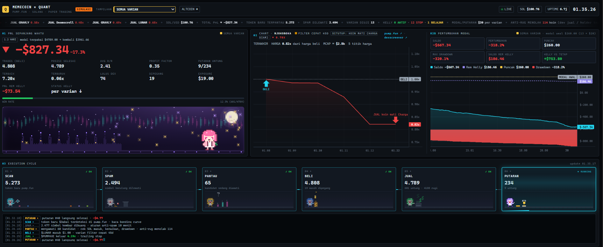
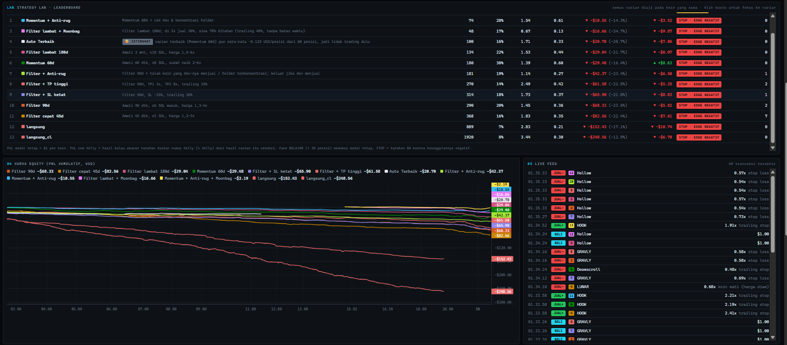
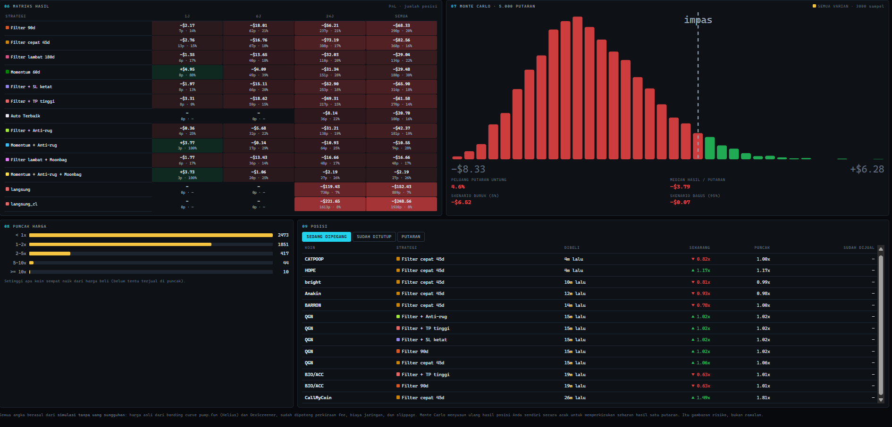
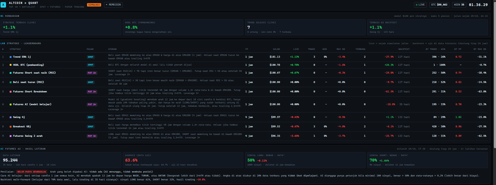
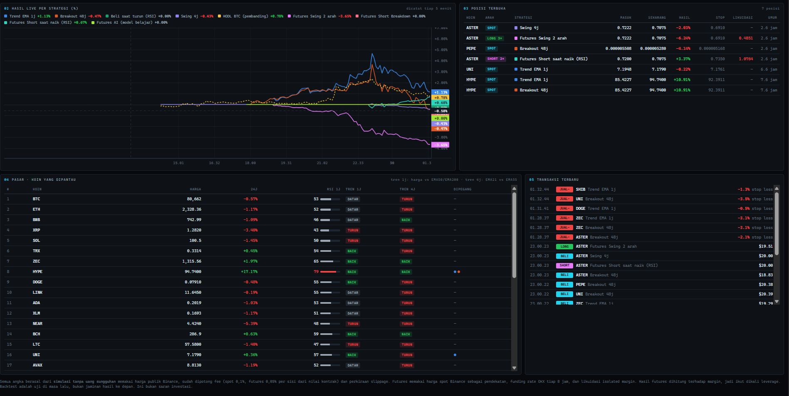
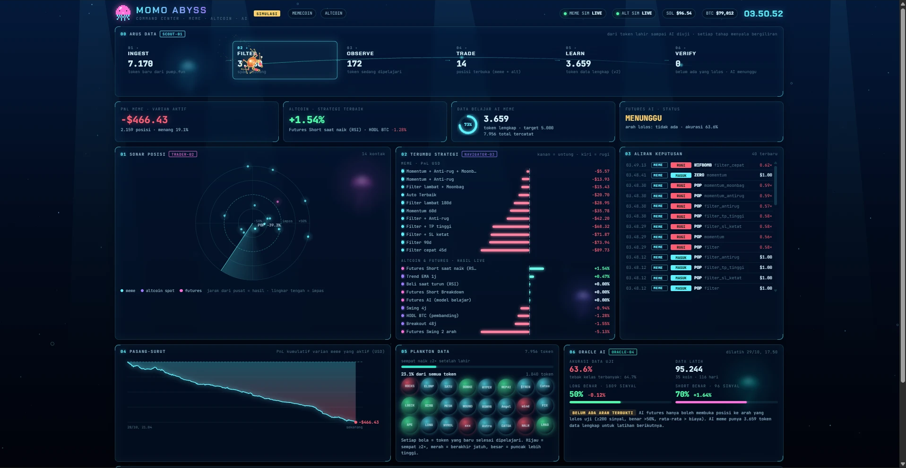
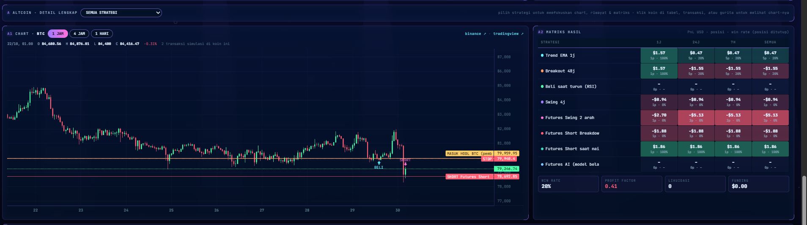
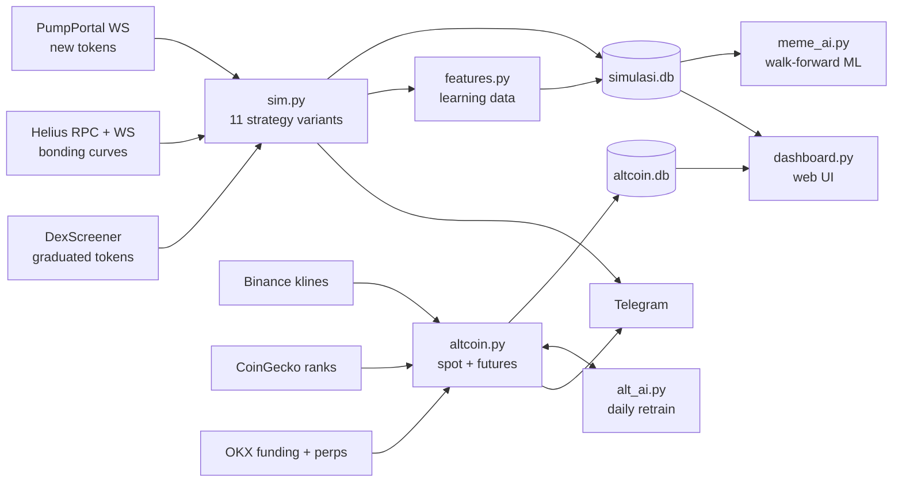

# Momo Quant Lab

**A paper-trading research lab for Solana meme coins and crypto altcoins.** It streams real on-chain and exchange data, runs many trading strategies side by side on the same feed, trains machine-learning models with walk-forward validation, and reports the results honestly, including when they lose.

> ⚠️ **Simulation only.** No wallet, no private keys, no real money. Nothing here is investment advice.

The project is documented in Bahasa Indonesia in [docs/PANDUAN.md](docs/PANDUAN.md), the full user guide. Research results are in [docs/findings.md](docs/findings.md).



---

## Screenshots

| Strategy Lab: leaderboard, equity curves, live feed | Risk analytics: result matrix, Monte Carlo, open positions |
|---|---|
|  |  |
| **Altcoin and futures: leaderboard with backtests, AI training report** | **Altcoin market: live equity, positions with liquidation price, trend scanner** |
|  |  |

## What it does

| Module | What it does |
|---|---|
| **Meme-coin simulator** (`sim.py`) | Listens to every new pump.fun token over WebSocket. It reads prices straight from the Solana **bonding-curve account** (Helius RPC plus real-time `accountSubscribe`), filters spam, and paper-trades **11 strategy variants in parallel**, each with its own $20 bankroll per round. |
| **Strategy Lab** (`strategies.py`) | A/B tests entry filters (observe window, SOL inflow, price multiple), anti-rug checks (dev selling, holder concentration), and exit rules (TP ladder, trailing stop, moonbag). The *Auto* variant picks the most statistically stable variant each round, scoring mean − std/√n, and sits out when everything is losing. |
| **Learning-data recorder** (`features.py`) | Records every token for 20 minutes: snapshots at 30/60/90/180 s, launch features (dev buy size, serial-creator count, copy-cat name count, socials), and the full price path so any exit rule can be replayed offline. |
| **Meme ML trainer** (`meme_ai.py`) | Replays each variant's exit rules over the recorded price paths with fees, dynamic slippage and network costs. It then trains a gradient-boosting classifier on entry-time features only and evaluates it walk-forward. |
| **Wallet Lab** (`wallet_lab.py`) | Reverse-engineers real pump.fun sniper wallets from public on-chain data (read-only). It finds wallets that repeatedly buy in the first transactions of new tokens, rebuilds their buy/sell round trips from each transaction's SOL and token deltas (fees, priority fees and tips included), and measures real PnL, entry speed, exit multiples, hold time, selectivity and which token traits they pick compared with all tokens. |
| **Altcoin and futures simulator** (`altcoin.py`) | Covers the top 30 coins by market cap plus a watchlist. It runs **spot** strategies (EMA trend, breakout, RSI dip, 4h swing) and **perpetual futures** with leverage, long and short, isolated-margin **liquidation** and real **funding rates** (OKX). A daily backtest is shared with the live engine, and HODL BTC is the benchmark. |
| **Futures AI** (`alt_ai.py`) | Gradient boosting on 18 candle and market-regime features predicts 12-hour direction (up, flat or down, scaled by ATR). It is retrained daily. **Safety gate:** it may only trade a direction that was proven out-of-sample (≥200 signals, >50% hit rate, mean > costs). |
| **Metrics, risk & cost calibration** (`metrics.py`, `risk.py`, `calibrate.py`) | One shared metrics module (profit factor, expectancy, t-stat, max drawdown, per-trade Sharpe/Sortino, fees, slippage, out-of-sample PF, walk-forward stability and an honest verdict). A deterministic risk layer (daily loss, drawdown, exposure, slippage limits, kill switch, duplicate-order guard) that no strategy or AI can override; it runs in *shadow* mode for research and *enforce* mode for validated strategies. `calibrate.py` measures real slippage from on-chain prices 1–5 s after each simulated decision. |
| **Shared exit engine** (`meme_engine.py`, `costs.py`) | One pure function holds every meme exit rule (stop loss, TP ladder, trailing, time limits, dead-coin exit) and one cost model holds the calibrated slippage. The live simulator and every backtest call the same code, so they cannot drift apart. |
| **Trade-flow recorder & Safety agent** (`flow.py`, `safety.py`) | Follows each new token for 20 minutes: every buy and sell with its wallet in the first 5 minutes, snapshots of unique buyers, snipers, same-size (bot) buys, wash trading, dev selling, serial snipers and SOL bought in the launch block, then a consistent outcome label (rug / dump / flat / normal / graduated). Streams from PumpPortal when an API key is set; otherwise samples 1 in 8 tokens by replaying their first minute from the public Solana RPC. The Safety agent scores every token in 4 layers (creator, launch, flow, holders) and is graded against those labels before it may filter anything. |
| **Altcoin history & technical analysis** (`alt_data.py`, `indicators.py`) | Downloads 1 h / 4 h / 1 d candles since 2022 through CCXT (Binance public data host, OKX fallback) with incremental updates. A NumPy indicator library (EMA 50/200, RSI, MACD, ADX, ATR, VWAP, relative volume, support/resistance, breakout + retest, BTC correlation, volatility) feeds a regime classifier and a multi-timeframe scanner. |
| **Research Engine** (`research.py`) | Tests each strategy hypothesis separately through 7 gates: full backtest, in-sample 2022–2024 (the only data used to pick parameters), out-of-sample 2025+, walk-forward (train 12 months, test 3, rolling), stress tests (2x costs, 1-bar late entry, top 5% trades removed, Monte Carlo drawdown), a significance bar raised for the number of combinations tried, and beating buy-and-hold BTC. Entries fill at the next bar's open, so nothing sees the future. |
| **Dashboard** (`dashboard.py`, `web/`) | A real-time web UI in **two themes** (see below): live equity curves, per-coin candlestick charts with trade markers, an animated execution pipeline, the strategy leaderboard, Monte Carlo risk, and the AI training report. |
| **Telegram bot** | Sends trade alerts, round summaries, and the `/status`, `/laporan`, `/stop`, `/mulai` and `/alt` commands. |

## Themes
The same data powers three themes. Each page has a **THEME: TERMINAL | ABYSS** switch, and moving between meme coins and altcoins keeps the current theme.

| | Terminal | Abyss (deep sea) | Prism (research console) |
|---|---|---|---|
| Meme coins | `/` with the pixel trader "Momo" | `/lab` command center with a data-carrying **crab** | `/prism` |
| Altcoins & futures | `/alt` | `/alt-abyss` with an **octopus** that holds every open position | `/prism-alt` |

**Prism** is a research console. Both pages share a live constellation of the 8 agents: each agent is a rotating 3D particle sphere with an animated glyph for its job, the research agent is a glass prism that splits the data beam into strategy rays (orbited by one dot per tested strategy, coloured by verdict), and the risk agent is an energy gate that turns amber or red when limits are hit. The verdict panel shows a strategy donut, a cost waterfall and the 6-step validation path of the best strategy. The meme page adds the full leaderboard, PnL curves, walk-forward heatmap, cost calibration and risk limits; the altcoin page adds its leaderboard, a candlestick chart per coin, backtests against HODL BTC and the futures AI gate.

The Abyss characters are procedural canvas animations, not sprites:
- The **crab** walks on 8 legs with inverse kinematics. Each foot stays planted and steps only when the body moves too far, alternating between leg groups. The crab carries data between pipeline stages and leaves glowing threads behind. It reacts to winning and losing trades, follows the cursor, and has idle behaviours: digging for pearls, dancing, blowing bubbles, sleeping.
- The **octopus** grabs each open position with a FABRIK-IK tentacle that stretches to reach it. Its skin colour follows the average PnL of open positions. It releases coins when positions close: winners float up and losers sink.

Charts are candlesticks in both themes. Meme-coin candles (15 s / 1 m / 5 m) are built from the bot's own bonding-curve price samples. Altcoin candles (1 h / 4 h / 1 d) come from Binance and include entry, stop and liquidation lines.



| Abyss altcoin chart & result matrix |
|---|
|  |

## Architecture



## Engineering details
- **Async Python** (`asyncio`, `httpx`, `websockets`): one process for each simulator, with WebSocket reconnect and back-off.
- **Realistic costs:** a platform fee per side, slippage that grows with recent price velocity, a network fee per transaction, futures taker fees, funding and liquidation.
- **Crash-safe:** open positions are persisted and resumed after a restart. The SQLite schema migrates automatically. Backups run daily, and a single-instance lock prevents duplicate runs.
- **No look-ahead:** ML features use only information available at entry. Validation is time-ordered (train on older data, test on newer).
- **Read-only dashboard:** it opens the databases in read-only mode, so it can never corrupt the simulators.

## Key findings (so far)
The full write-up is in [docs/findings.md](docs/findings.md).
1. **Costs dominate.** Fees, slippage and network costs add up to about **11% per round trip** on a small meme-coin position. A coin that does nothing still loses money.
2. **No meme variant is profitable yet** after more than 4,000 simulated positions. Buying every new token was the worst at about −$400, so those variants were retired.
3. **A high AUC can mislead.** A first ML model reached AUC 0.80 at picking "profitable" tokens, but its top picks still averaged below 1× after costs. It had learned to spot *volatile* coins, not *rising* ones.
4. **Leverage magnifies a weak edge into large losses.** In backtests every futures strategy underperformed simply holding BTC.

The value of the lab is that it gives these answers quickly and honestly, before any real money is at risk.

## Quick start (Windows)
```bash
pip install -r requirements.txt
copy .env.example .env        # then fill in your Helius key / Telegram bot (optional)
python sim.py                 # meme-coin simulator
python altcoin.py             # altcoin + futures simulator
python dashboard.py           # http://localhost:8050  and  /alt
python altcoin.py --backtest  # one-off backtest of all altcoin strategies
python meme_ai.py --entry 90  # train/evaluate the meme-coin model (needs ≥1500 recorded tokens)
python wallet_lab.py discover      # find wallets that keep buying first (needs Helius)
python wallet_lab.py profile       # dissect their trades; then: python wallet_lab.py report
python wallet_lab.py backtest      # replay the snipers' coin filters + scalping exits on recorded prices
python calibrate.py --n 150       # measure real slippage on-chain (needs Helius)
python alt_data.py                # download / update altcoin candles since 2022
python indicators.py SOL          # multi-timeframe technical analysis of one coin
python flow.py                    # trade-flow labels and Safety score report
python research.py                # run the hypothesis research engine (results in Prism)
python -m unittest discover tests
```
`mulai_semua.bat` starts everything in minimized windows, and `pasang_autostart.bat` starts it at Windows login.

## Tech stack
Python 3.12 · asyncio · httpx · websockets · SQLite · NumPy · scikit-learn · Lightweight Charts · vanilla JS/CSS · Solana RPC · Telegram Bot API

## License
MIT. See [LICENSE](LICENSE).
